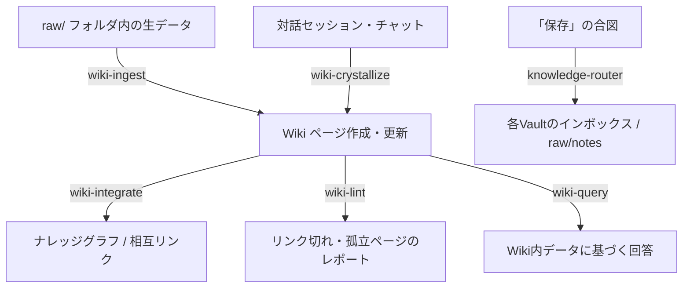

# LLM-Wiki ユーザーマニュアル：パーソナル・ナレッジベース構築スキル

本マニュアルは、[llm-wiki-claude-skills](../README_ja.md) プロジェクトで提供されている、Claude用エージェントスキルを利用してローカル環境にパーソナルWiki（ナレッジベース）を構築・管理するためのガイドです。

> [!NOTE]
> 本スキル群は、エージェント（Claude）がローカルファイルシステムにアクセスできる環境（MCP等のファイルシステム連携）で動作します。

---

## 1. 概要とディレクトリ構造

本システムは、Markdownファイルと相互の内部リンク（Wikilink `[[Page Name]]`）を利用してナレッジを蓄積します。エージェントが一時的なチャット対話や生のソースデータから恒久的な知識ページを合成し、整理整頓（インデックス更新やリンク切れチェック）を自律的に行います。

### 推奨されるディレクトリ構成

```text
your-wiki/
├── wiki-config.md     ← Wiki全体の動作設定（手動、または初回起動時に自動作成）
├── CLAUDE.md          ← エージェントが守るべきローカルルールや定義
├── index.md           ← Wikiページの目次・一覧（エージェントが管理）
├── log.md             ← 処理ログ（エージェントが追記）
├── raw/               ← 処理したい生ファイル（PDF, CSV, 画像, メモ）を置く場所
└── ingested/          ← 処理完了後にアーカイブされるファイル格納場所
    ├── clippings/     ← Webクリップ等
    ├── documentation/ ← 公式ドキュメントや技術仕様書
    ├── papers/        ← 論文や学術ドキュメント
    ├── articles/      ← ブログ記事やコラム
    ├── data/          ← CSVやJSONなどのデータ
    └── notes/         ← 雑記や手書きメモ
```

---

## 2. 共通設定ファイル (`wiki-config.md`)

すべてのスキルは、実行時に `wiki-config.md` を検索してWikiのルートディレクトリを特定し、以下の設定を読み込みます。

| 設定項目 | 説明 |
| :--- | :--- |
| `blacklist` | Wikiページの新規作成を禁止するフォルダ（Gitリポジトリ、ソースコード等）。 |
| `index_excludes` | `index.md` の追跡対象外とするフォルダ（通常 `raw/`, `archive/`, `ingested/` など）。 |
| `ingested_folder` | 処理済みソースファイルの移動先ディレクトリ名。 |
| `ingested_subdirs` | `ingested/` 内に作成する分類用サブフォルダのリスト。 |
| `log_format` | `log.md` に書き込むログのフォーマット形式。 |

> [!IMPORTANT]
> `wiki-config.md` が見つからない状態でスキルを実行すると、初回のみ初期化（`init`）プロセスが走り、設定ファイルと必要なフォルダ群が自動で作成されます。

---

## 3. スキル詳細リファレンス

本プロジェクトに含まれる6つのスキルの詳細です。



### 3.1 [wiki-ingest](../wiki-ingest/SKILL.md)

生のデータを整理されたWikiページへとコンパイルし、元ファイルを自動でアーカイブします。

* **トリガーフレーズ**: `/wiki-ingest` 、または「rawフォルダを処理して」「ファイルをインポートして」など
* **必要権限**: ファイルシステムの読み取り・書き込み・移動・検索
* **ワークフロー**:
  1. `<wiki_root>/raw/` 内の全ファイルを再帰的にスキャン。
  2. 各ファイルを読み込み、内容を解析（PDFはテキスト抽出、画像はビジョン機能があれば利用）。
  3. ファイルの内容に基づいて適切なカテゴリ（`clippings`, `papers`, `documentation`, `articles`, `data`, `notes`）に分類。
  4. 既存の `index.md` を参照し、重複するトピックがある場合は既存のWikiページをアップデート、新規の場合は新ページを適切なサブフォルダに作成。
  5. 新ページには以下のYAMLフロントマットと「Sources（ソース）」セクション（ローカル移動先パス・元URL）を記述：
     ```yaml
     ---
     title: ページタイトル
     version: 1.0
     date: YYYY-MM-DD
     changes: Created by wiki-ingest from [元ファイル名]
     ---
     ```
  6. 作成/更新したページへの `[[wikilink]]` などを関連ページに追加。
  7. 元の生ファイルを `ingested/<分類サブフォルダ>/` に移動（この移動完了をもってアトミックなコミットとみなします）。
  8. `index.md` を更新し、`log.md` に処理結果を記録。

---

### 3.2 [wiki-query](../wiki-query/SKILL.md)

Wikiナレッジベース内のデータのみに基づいてユーザーの質問に回答します。一般的なモデル知識に依存しない正確な回答が可能です。

* **トリガーフレーズ**: `/wiki-query` 、または「Wikiから検索して」「Wikiによると〜」など
* **必要権限**: ファイルシステムの読み取り（回答をWikiに新規保存する場合は書き込みも必要）
* **ワークフロー**:
  1. `index.md` を読み込み、質問に関連するWikiページを特定。
  2. 特定されたWikiファイル群の本文を読み込む。
  3. 情報を集約し、関連するWikiページへの `[[wikilink]]` を引用元として付与しながら日本語で回答を作成。
  4. ユーザーが回答を気に入った場合、その回答内容を新しいWikiページとして保存するオプションを提供。

---

### 3.3 [wiki-lint](../wiki-lint/SKILL.md)

Wiki全体の「健康状態」を診断し、不整合を検出してレポートを作成します。

* **トリガーフレーズ**: `/wiki-lint` 、または「Wikiのリンクをチェックして」「健康診断して」など
* **必要権限**: ファイルシステムの読み取り、および `archive/` への書き込み
* **診断対象**:
  - 切れたWikiリンク（存在しないファイルを指す `[[wikilink]]`）
  - どこからもリンクされていない「孤立したページ」
  - 存在しないファイルを指している `index.md` の古いエントリ
  - `ingested/` 内のソースファイルと紐づいていない孤立したWikiページ
  - 命名規則違反（タイトルやファイル名における不適切な記号の使用など）
  - フロントマター `sources:` のうち、Vault 内パス（`ingested/`・`raw/` で始まるもの）が実在しないもの（URL などの外部出典は検査しない）
* **ワークフロー**:
  1. Wiki内の全Markdownファイルをスキャンしてリンク情報をマップ。
  2. 上記の診断項目に基づいて不整合を検出。
  3. 検出結果を `archive/lint-YYYY-MM-DD.md` として出力（**注意：ファイルを自動修正することはなく、レポートの作成のみを行います**）。

---

### 3.4 [wiki-integrate](../wiki-integrate/SKILL.md)

新規作成されたページや、大幅に更新されたページをナレッジグラフへ織り込みます。

* **トリガーフレーズ**: `/wiki-integrate` 、または「このページをインテグレートして」「リンクを繋いで」など
* **必要権限**: ファイルシステムの読み取り・書き込み
* **ワークフロー**:
  1. 指定されたWikiページの内容を読み取る。
  2. `index.md` にそのページが登録されているか確認し、無ければ適切なカテゴリ配下に追加。
  3. 他のWikiページをスキャンし、今回のページと内容的に関連があるページを検索。
  4. 関連ページから新ページへのリンク、および新ページから関連ページへの双方向リンク（backlinks）を追加。
  5. 処理結果を `log.md` に記録。

---

### 3.5 [wiki-crystallize](../wiki-crystallize/SKILL.md)

長時間のチャットセッションや作業履歴を、再利用可能な恒久的なWikiページに昇華（結晶化）させます。

* **トリガーフレーズ**: `/wiki-crystallize` 、または「今の対話をまとめて保存して」「結晶化して」など
* **必要権限**: ファイルシステムの読み取り・書き込み
* **ワークフロー**:
  1. 現在のチャットのスレッド全体（決定事項、背景、技術的パターン、未解決の課題など）を分析。
  2. 余分なやり取りを排除し、構造化された「まとめページ」のMarkdownを生成。
  3. 新しいWikiページとして書き出す（または既存のハブページや `overview.md` を更新）。
  4. 作成後は `wiki-integrate` と同様に `index.md` への追加と相互リンクを処理。

---

### 3.6 [knowledge-router](../knowledge-router/SKILL.md)

ユーザーがチャット中に「これを残しておいて」と言った際、内容の性質（内省的なものか、客観的な技術知識か）を判断し、適切な保管先に振り分けます。

* **トリガーフレーズ**: 「保存」「inboxに入れて」「obsidianに残して」 `/knowledge-router` など
* **必要権限**: 各Vault（`my-knowledge/`, `my-research/`）のインボックスへの書き込み
* **振り分けルール**:
  - **内省的（Introspective）情報** (自身の感情、日記、疑問など)
    - 保存先: `~/Obsidian/my-knowledge/inbox/`
    - 命名規則: `q-{タイトル}-YYYY-MM-DD.md` (質問)、`j-{タイトル}-YYYY-MM-DD.md` (日記など)
  - **客観的・技術的（External-knowledge）情報** (技術仕様、解説、事実など)
    - 保存先: `~/Obsidian/my-research/raw/notes/`
    - 命名規則: `claude-{トピック}-YYYY-MM-DD.md`
* **ワークフロー**:
  1. チャットの内容から保存すべき論点をセグメント化。
  2. 性質を判定して振り分け先を決定。
  3. 保存するファイルの内容（ドラフト）と書き込み先フォルダの計画をユーザーに提示し、承認（ユーザーの同意）を得てから書き込みを実行。

---

## 4. プライバシーと運用のベストプラクティス

> [!CAUTION]
> **プライバシー境界の管理**
> エージェントに提供するMCPのアクセス権限（`allowedDirectories`）は、必ずWikiのルート（例: `Agent Access` などの専用フォルダ）のみに限定してください。ユーザーのホームディレクトリ全体やプライベートな金融・医療情報があるフォルダをエージェントに読み込ませないようにしてください。

- **`blacklist`の活用**: コードリポジトリ（`.git`）やビルド成果物のフォルダなどを `wiki-config.md` の `blacklist` に指定し、エージェントによる意図しない書き込みを防いでください。
- **定期的な `/wiki-lint` の実行**: ナレッジベースが肥大化するとリンク切れや情報の孤立が起きやすくなります。週に1回程度 `wiki-lint` を実行して整理することを推奨します。
- **対話の「結晶化」**: 複雑な問題解決やブレインストーミングが終わったら、そのままスレッドを閉じるのではなく、`/wiki-crystallize` を実行してWikiに残すことで、将来新しいセッションを始める際のスムーズなコンテキスト共有（コンパウンド効果）が期待できます。
